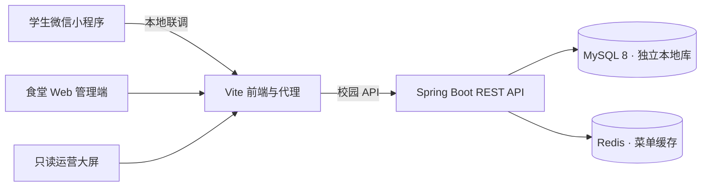

# 饭点系统设计说明

学生端新增 `miniprogram/` 原生微信小程序，使用 WXML/WXSS/JS 实现六个页面，`utils/api.js` 通过 `wx.request` 调用原有 `/campus` API，并以微信本地存储保存校园 JWT。业务权限、计价、库存和预约事务仍由原 Spring Boot 服务执行。微信 AppSecret 与商户凭证没有写入前端；当前使用学号登录及模拟支付。

## 1. 总体结构

食堂管理后台和运营大屏共用 Vue 工程，路由分别为 `/admin` 和 `/screen`。小程序工程位于 `miniprogram/`，本地联调时也可通过 Vite 访问 `/campus/**`，由 Vite 转发到 Spring Boot。生产部署需要单独配置静态文件托管、TLS、密钥管理、域名和反向代理。

## 2. 技术选型

| 层 | 技术 | 说明 |
| --- | --- | --- |
| 学生端 | 微信小程序、JS、WXML、WXSS | 点餐、预约和取餐凭证 |
| Web 前端 | Vue 3、Vue Router、Vite | 食堂管理后台和运营大屏 |
| 图表与三维场景 | ECharts 6、Three.js | 管理后台 3 张图、大屏 5 张图；中心食堂模型为程序生成的运营示意，窗口状态来自接口 |
| 服务端 | Java 17、Spring Boot 2.7、Spring MVC | 沿用上游分层和 `Result` 统一返回 |
| 持久层 | MyBatis、MySQL 8 | 复用用户、购物车、订单和订单明细等原表；校园扩展表存预约域信息 |
| 缓存 | Redis | 菜单查询短缓存，库存扣减仍以 MySQL 事务为准 |
| 身份认证 | JWT、Apache Shiro Realm | token 通过签名、时效、账号状态及数据库角色校验；无服务端 Session |

## 3. 服务端模块

- `CampusController`：校园认证、公开菜单、学生、工作人员 API 路由。
- `CampusAuthService`：学生注册登录、当前身份读取、令牌签发。
- `CampusAuthInterceptor`、`CampusRealm`：认证和角色边界；学生、窗口、管理员和大屏展示账号分开授权。
- `CampusCatalogService`：窗口、菜单、预约时段、收藏、公告、反馈、评价和管理统计。
- `CampusOrderService`：购物车加减、预约事务、库存/名额管理、模拟支付、取消改约、备餐和核销。
- `CampusScreenService`：只读大屏聚合；不复用会返回学生资料或取餐码的订单查询。
- `CampusMapper` + `CampusMapper.xml`：校园域 SQL。订单和库存关键路径使用 MySQL 行锁/条件更新与事务。

## 4. 数据模型

原项目业务表保留 11 张，包括 `user`、`dish`、`category`、`shopping_cart`、`orders` 和 `order_detail`。校园扩展表：

| 表 | 作用 |
| --- | --- |
| `campus_account` | 学号/工作账号、角色、窗口绑定和加盐密码摘要 |
| `campus_window` | 食堂窗口、营业状态和取餐位置 |
| `campus_dish` | 原菜品与校园窗口库存、营养示意值、标签的关联 |
| `campus_slot` | 日期、取餐时间段、容量和已预约名额 |
| `campus_order` | 原订单对应的窗口、时段、请求幂等键、取餐码和演示标记 |
| `campus_favorite` | 学生收藏关系 |
| `campus_review` | 已完成预约的单次评价 |
| `campus_notice` | 校园公告 |
| `campus_feedback` | 学生发往指定窗口的反馈和回复 |

`database/schema.sql` 是上游原表结构摘录；`database/campus.sql` 是校园扩展结构；演示数据由 `scripts/seed_data.py` 写入独立本地库。项目初始化脚本不对已有数据库执行 DROP 或清空。

## 5. 预约和取餐主流程

1. 学生登录后选择窗口，菜单从 Redis 读取；缓存 miss 时从 MySQL 读取，维护菜品或评价后清理相关缓存。
2. 学生逐份调整购物车。服务端根据用户身份确定购物车，不接受客户端传入学生 ID；一份购物车不能混合窗口。
3. 学生选择开放时段并提交预约。服务端按用户 → 时段 → 菜品库存的顺序校验、加锁、扣减，并从数据库计算价格；相同用户的相同 requestId 返回原订单。
4. 演示支付把订单推进到待接单并生成唯一八位码。该过程不会对外扣款。
5. 工作人员/管理员接单后进入备餐，再改为待取餐。学生在“我的预约”查看取餐码，工作人员核对码后核销。
6. 学生取消待支付/待接单预约时归还库存和时段名额；已开始备餐则拒绝取消。取餐完成后可提交一次评价。

## 6. 大屏数据与权限

`GET /campus/screen/overview?date=YYYY-MM-DD` 返回摘要、窗口预约状态、预约名额、时段占用、近七日趋势、销量、分类偏好、最近订单状态。选择日期只允许今天或明天。大屏账号只具有 `SCREEN` 角色，只能进入该只读聚合接口；订单明细及姓名、学号、取餐码不进入响应。管理员也可以访问大屏。

## 7. 本地运行边界

`start.ps1` 仅启动当前工作区专用 MySQL、Redis、Spring Boot 和 Vite；端口分别为 `13316`、`16379`、`18088`、`15173`，数据库、Redis 密码和 JWT 密钥保存在忽略文件 `.local/` 中。脚本确认端口进程属于此工作区后才复用/停止。服务默认监听本机，小程序模拟器通过 15173 端口连接，真机连接方法见[小程序说明](../miniprogram/README.md)。

## 8. 大屏视觉参考

大屏面向 1920×1080 全屏展示，参考[阿里云 DataV 设计库](https://help.aliyun.com/zh/datav/datav-7-0/user-guide/design-library)的主视觉居中、字体规范与统一主题方法，采用墨色背景、暖橙重点和绿灰辅助色。顶部指标按主次排列，中央为带实体材质、阴影和庭院设施的 Three.js 食堂示意，侧翼为分析图表，底部为轻量动态信息。页面不使用 DataV 平台模板、素材或云端运行时。

中部窗口标注与数据库窗口对应，选择标注或服务台会切换窗口详情；巡航和复位只改变展示视角。节点按接口列表顺序排列，模型布局不对应真实地理位置。大屏保留五个 ECharts 实例：核销金额走势、菜品排名、分类占比条、窗口订单状态桑基图、预约时段柱图。所有数值来自 `CampusScreenService`，近七日金额按已核销订单的下单日期汇总。

外围护角使用 SVG 分别绘制顶面、倒角和暗侧面，配合投影呈现金属厚度；侧轨使用分层渐变表现内凹槽与刻度。外围装饰层保持鼠标穿透，窄屏缩小护角并隐藏侧轨。

## 运营管理扩展（2026-11-07）

四项核心运营能力沿用 `/campus/staff/**` 的 JWT/Shiro 身份、原 `Result`/`PageResult`、Spring 事务与 MyBatis XML，未更换 ORM 或新增数据库表。

- `CampusOperationsController → CampusOperationsService → CampusOperationsMapper`：工作账号新增、编辑、启停、密码重置以及窗口资料、营业时间和营业状态。原 `CampusMapper.insertUser/insertAccount` 继续保证用户及校园身份同一事务落库。账号查询仅返回 ADMIN、STAFF、SCREEN，不读密码字段。
- `CampusOrderQueryService.page → CampusOperationsMapper.orderCount/orderPage/pageOrderDetails`：全量历史订单按权限、状态、取餐日期及关键词查询，最多每页 50 笔；一页明细批量读取。原最近 100 笔仅供总览近期预约使用。
- `CampusOrderService.terminate → 原 AlipayGatewayService.refund → cancelLocked`：原因校验、订单行锁、状态校验、按原支付方式退款，再归还库存及名额；拒单原因保留在原订单字段。已取消直接返回原结果，退款失败不提交状态和资源变更；菜单缓存在提交后失效。
- `CampusHours` 解析并规范既有 `opening_hours`；`CampusCatalogService.slots` 发布当前区间的二十分钟网格，`submit/reschedule` 同步校验新营业时间。既有预约和已发布容量不追溯修改。
- `CampusPassword.version` 用服务端 HMAC 绑定用户、密码及授权范围。`CampusRealm` 每次读取真实账号并核对版本；密码重置、调岗、换窗使旧令牌失效，停用立即拒绝访问。账号操作串行锁定管理员，再以当前读确认操作人仍可用，防止并发互停后没有管理员。
- 新前端 `OperationsSettings` 复用自定义下拉、表单弹层和自适应分页；`OrderDispatch` 通过 `/staff/orders/page` 查询当前页，取消旧筛选请求并每五秒同步，拒单/取消在明细内确认原因。原菜单、接单、备妥及凭码核销入口继续保留。

接口包括 `/staff/accounts`、`/staff/accounts/{id}`、`/staff/accounts/{id}/status`、`/staff/accounts/{id}/password`、`/staff/settings/windows`、`/staff/settings/windows/{id}`、`/staff/settings/windows/{id}/status`、`/staff/orders/page`、`/staff/orders/{id}/reject` 和 `/staff/orders/{id}/cancel`。具体请求字段与权限、状态规则见 `CampusOperationsModels` 及对应 Service Javadoc。
